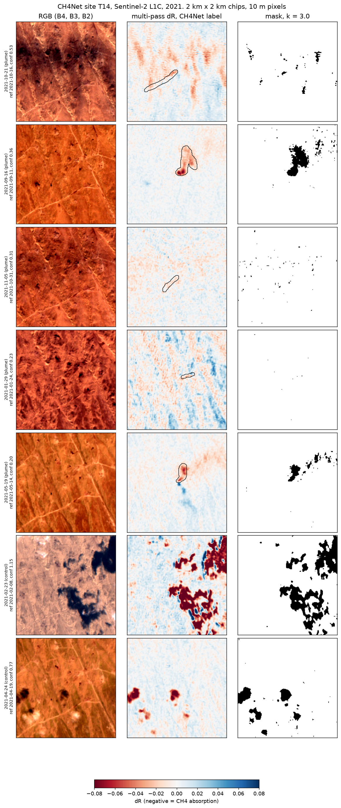
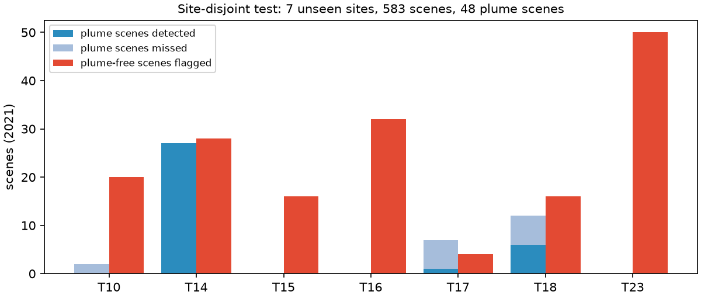
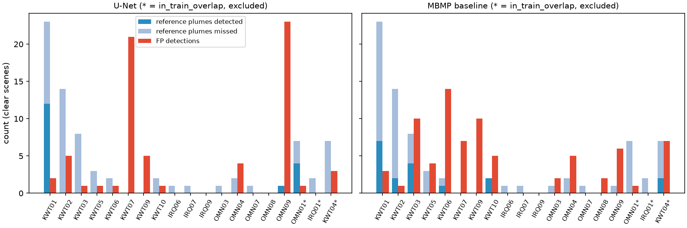
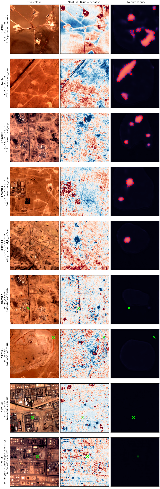

# PlumeScout

Methane plume detection over Gulf oil fields from Sentinel-2.

PlumeScout is an open pipeline that looks for methane super-emitter plumes in free Sentinel-2 L1C
imagery over oil and gas sites in Kuwait, southern Iraq and Oman, and checks every detection against
NASA EMIT V002 and Carbon Mapper plume observations. It's a non-commercial portfolio project, and the
headline result is a negative one: a U-Net trained on public Turkmenistan labels doesn't beat the
classic band-ratio baseline on unseen Gulf sites.

## Why it matters

Methane from oil and gas is one of the fastest levers on near-term warming, and large point sources
are visible from space. Sentinel-2 revisits every few days and carries two shortwave infrared bands, so it can
flag the biggest plumes for free, but those broad bands make detection noisy. This project measures how
well a public-label model transfers to a new region, with validation that doesn't flatter it.

## Data

| Dataset | Use | Licence |
|---|---|---|
| Sentinel-2 L1C (`COPERNICUS/S2_HARMONIZED`, via Google Earth Engine) | Inference imagery, 200 x 200 px chips at 10 m | Copernicus open data |
| CH4Net (Vaughan et al. 2024, HF `av555/ch4net`) | Training labels, 23 Turkmenistan sites | CC BY-NC-ND 4.0 |
| MARS-S2L train/val locations (HF `UNEP-IMEO/MARS-S2L`) | Leakage check only (2 km) | CC BY-NC-SA 4.0 |
| NASA EMIT L2B CH4 plume complexes and enhancement granules, V002 (LP DAAC, `earthaccess`) | Reference plumes and true negatives | NASA open data |
| Carbon Mapper plumes (Tanager and EMIT retrievals) | Reference plumes | Non-commercial terms, not redistributed |
| NASA FIRMS VIIRS 375 m active fire | Flare mask | NASA open data |

## Method

1. **Baseline.** Multi-band multi-pass (MBMP, Varon et al. 2021): dR = (c R12 - R11) / R11 minus the same
   quantity for the most recent clear scene in the prior 30 days. Plumes are negative. Mask: dR below the
   median minus 3 robust standard deviations.
2. **Model.** U-Net with a ResNet-34 encoder, 13 inputs (12 bands plus the MBMP field), BCE + Dice loss,
   flips and 90 degree rotations only. Trained on CH4Net 2017 to 2020; checkpoint chosen on CH4Net
   validation scene balanced accuracy.
3. **Leakage control.** Splits are by site, never by image. CH4Net has no site metadata, so site ids for all
   10,983 images were recovered from frame-shape runs and template matching (0 label-order violations).
   Gulf sites within 2 km of a CH4Net or MARS-S2L training location are flagged and excluded.
4. **Gulf sites.** EMIT and Carbon Mapper plumes clustered at 1 km gave 66 candidates; 19 were kept
   (16 eligible, 3 flagged). Chips were downloaded within 1 day of each reference plume or EMIT overpass.
5. **Inference.** Our L1C chips are mapped to CH4Net's input scale with a per-band fit made on Turkmenistan
   only. The operating point (threshold 0.2, plume = component of at least 116 px) was frozen before any
   Gulf inference. Components within 750 m and 12 h of a VIIRS fire are masked as flares.
6. **Matching.** A detection is a true positive if a reference plume lies within 1 km and 1 day; a false
   positive if EMIT observed the site within 1 day and reported no plume; otherwise it's unverified and not
   counted. A reference plume with a clear Sentinel-2 scene and no detection is a false negative.

## Results

Every metric comes with its counts. CIs are 95% bootstrap intervals: by scene for the paper split, by
site elsewhere.

| Setting | Data | Recall | Precision | Other |
|---|---|---|---|---|
| CH4Net test 2021, paper split (same 23 sites as training) | 2,473 scenes, 275 with plumes | 0.884 [0.846, 0.919] (scene) | 0.214 [0.191, 0.240] | FPR 0.406; paper reports recall 0.84 at FPR 0.24 |
| CH4Net 2021, site-disjoint, one split | 583 scenes, 48 with plumes, 7 unseen sites | 0.521 [0.100, 0.795] (scene) | 0.176 [0.007, 0.361] | balanced accuracy 0.651 [0.411, 0.763] |
| CH4Net 2021, site-disjoint, 5-fold grouped CV | 2,473 scenes, 275 with plumes, all 23 sites unseen once | 0.542 [0.321, 0.703] (scene) | 0.258 [0.105, 0.410] | FPR 0.195; balanced accuracy 0.673 [0.567, 0.748]; folds range 0.48 to 0.79 |
| Gulf, U-Net | 16 sites, 59 reference plumes, 143 clear EMIT no-plume scenes | 0.220 [0.000, 0.414] (plume) | 0.190 [0.000, 0.462] | 44.8 [12.9, 82.7] false detections per 100 clear no-plume scenes |
| Gulf, MBMP baseline | same | 0.271 [0.125, 0.412] (plume) | 0.188 [0.071, 0.312] | 48.3 [27.8, 69.6] per 100 |

What the numbers say:

- The paper-split number mostly measures how well the model learns 23 known sites. On unseen sites,
  balanced accuracy drops from 0.739 to 0.651 on one split. Over 5 grouped folds that test every site
  once, it's 0.673 [0.567, 0.748]. Each fold picks its own threshold on validation sites, and those picks
  range from 0.1 to 0.9, so the operating point is unstable. Two folds sit near chance (0.48 and 0.53).
- In the Gulf, the U-Net doesn't beat MBMP. Its detections cluster at one site (KWT01 holds 12 of its 13
  detected plumes) and 14 of 16 eligible sites have none.
- The model leans almost entirely on the MBMP channel: on Turkmenistan, blanking it drops recall to 0.
  So MBMP artefacts, such as surface change at facility pads and linear road edges, become false detections.
- Only 4 EMIT plumes had a clear Sentinel-2 scene within 1 day, so the positives are mostly Carbon Mapper
  plumes, many of which may sit below what Sentinel-2 can see.

| | |
|---|---|
|  |  |
| MBMP enhancement on a known plume date (Phase 1). | Unseen CH4Net sites: recall depends on a single site. |
|  |  |
| Gulf: detected and missed reference plumes, and false detections, by site. | False positives and misses chosen by a fixed rule. |

Full tables: [`notebooks/02_train_ch4net.ipynb`](notebooks/02_train_ch4net.ipynb) and
[`notebooks/04_evaluation.ipynb`](notebooks/04_evaluation.ipynb).

## Limitations

- Sentinel-2 only sees large plumes (super-emitters); many Carbon Mapper plumes are probably below its
  detection limit, and this evaluation can't separate those from model misses.
- Bright desert surfaces, facility surfaces, cloud edges and flares cause false positives.
- Validation is limited by EMIT and Carbon Mapper overpass coverage: 4 EMIT plumes had a clear matching
  scene, and 16 sites give wide confidence intervals.
- No emission rate quantification. Detections are coordinates and dates only.
- CH4Net inputs are 8-bit display values; Gulf chips are mapped to that scale with a fit made on
  Turkmenistan, and CH4Net's exact MBMP preprocessing isn't reproduced.
- One frozen operating point and one seed. Site-disjoint performance comes from 5 grouped folds of
  10 epochs each, and the threshold picked on validation sites varies from 0.1 to 0.9 across folds.

## Reproduce

Windows, Python 3.11, [uv](https://docs.astral.sh/uv/). Secrets go in `.env` (see `.env.example`):
Earthdata login, FIRMS map key, Hugging Face token (CH4Net is gated), Google Earth Engine project.

```powershell
uv sync
uv run pytest                                          # 122 tests
uv run python -m plumescout.ch4net_sites               # site ids for CH4Net images
uv run python -m plumescout.train --config configs/train.yaml --run-name paper_allbands_30ep
uv run python -m plumescout.sites                      # Gulf sites and references
uv run python -m plumescout.s2_download --gulf         # Sentinel-2 chips (GEE)
uv run python -m plumescout.firms                      # VIIRS fires
uv run python -m plumescout.infer                      # detections (frozen operating point)
uv run python -m plumescout.evaluate                   # Gulf metrics
uv run python -m plumescout.demo; uv run python app/app.py
```

Carbon Mapper exports aren't included; download them from data.carbonmapper.org into
`data/raw/carbonmapper/`. Model weights aren't published (CH4Net's licence doesn't allow derivatives
to be shared without permission).

## Citations

- Vaughan, A., Mateo-Garcia, G., Gomez-Chova, L., Ruzicka, V., Guanter, L. and Irakulis-Loitxate, I.
  (2024). CH4Net: a deep learning model for monitoring methane super-emitters with Sentinel-2 imagery.
  Atmospheric Measurement Techniques, 17, 2583. doi:10.5194/amt-17-2583-2024
- Mateo-Garcia, G., Allen, A., Irakulis-Loitxate, I. et al. (2025). Artificial intelligence for methane
  detection: from continuous monitoring to verified mitigation. arXiv:2511.21777 (MARS-S2L)
- Varon, D. J., Jervis, D., McKeever, J., Spence, I., Gains, D. and Jacob, D. J. (2021). High-frequency
  monitoring of anomalous methane point sources with multispectral Sentinel-2 satellite observations.
  Atmospheric Measurement Techniques, 14, 2771. doi:10.5194/amt-14-2771-2021
- NASA EMIT L2B Methane Plume Complexes and Enhancement Data, V002 (EMITL2BCH4PLM, EMITL2BCH4ENH),
  LP DAAC.
- Carbon Mapper plume data, data.carbonmapper.org.

## Licence and attribution

Code: non-commercial portfolio project. Contains modified Copernicus Sentinel-2 data. Derived outputs
inherit the non-commercial terms of CH4Net, MARS-S2L and Carbon Mapper.
